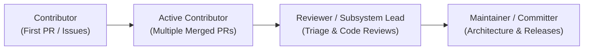

# Project Governance & Community Charter

This document outlines the governance model, decision-making framework, and contributor progression path for the **APEX AI Recommendation System** open-source project.

---

## 🏛️ Governance Philosophy

APEX is dedicated to being an inclusive, transparent, and meritocratic open-source project. We believe that great software is built through rigorous debate, reproducible evidence, respectful collaboration, and welcoming mentorship for contributors at all stages of their journey.

---

## 👥 Roles & Responsibilities

The project community is organized into four main roles:

### 1. Contributors
Anyone who submits issues, reviews pull requests, contributes code, improves documentation, or helps other users in community forums.
- **Privileges**: Can open issues, propose PRs, and participate in public design discussions.
- **Responsibilities**: Follow the [Code of Conduct](CODE_OF_CONDUCT.md) and adhere to repository coding standards in [`CONTRIBUTING.md`](CONTRIBUTING.md).

### 2. Reviewers
Experienced contributors with deep technical knowledge of specific subsystems (e.g., PyTorch models, Rust core, Databricks ETL, frontend).
- **Privileges**: Assigned to review pull requests, triage issues, and recommend PR merges.
- **Responsibilities**: Provide prompt, constructive, and thorough code reviews; verify test coverage and regression impacts.

### 3. Maintainers / Committers
Core team members responsible for the architectural direction, security, release cycles, and overall health of the repository.
- **Privileges**: Write and merge access to `main`, repository administration, release publishing, and conflict resolution.
- **Responsibilities**: Maintain CI/CD pipelines, uphold security standards, triage critical bugs, mentor GSoC students, and maintain backwards compatibility.

### 4. GSoC Mentors
Designated maintainers and reviewers who guide Google Summer of Code (GSoC) contributors throughout their project lifecycle.
- **Responsibilities**: Review proposals, conduct weekly 1-on-1 syncs, assist with unblocking technical hurdles, provide evaluations, and ensure smooth PR integration.

---

## 🧗 Contributor Ladder

Contributors can advance through demonstrated technical contributions, peer reviews, and adherence to community values:

- **Becoming a Reviewer**: Nominated by an existing maintainer after demonstrating consistent, high-quality PRs and active, thoughtful reviews on at least 5 other PRs.
- **Becoming a Maintainer**: Approved by consensus among existing maintainers based on sustained leadership, architectural stewardship, and community mentorship.

---

## 🗳️ Decision-Making Process

We follow a **Consensus-Seeking Decision Model**:

1. **Informal Consensus**: Most daily engineering decisions (bug fixes, small enhancements, test improvements) are agreed upon via pull request reviews (requiring at least 1 approving review from a maintainer).
2. **Request for Comments (RFC)**: Major architectural changes (e.g., adding a new model architecture, changing sharding schemes, altering database schemas) require an RFC issue:
   - The proposer opens an issue labeled `rfc`.
   - The issue outlines motivation, architectural design, trade-offs, and alternatives.
   - The community has a minimum of 7 days to discuss and offer feedback.
   - Maintainers approve by consensus (or 2/3 majority vote if consensus cannot be reached).

---

## 🤝 Conflict Resolution

Disagreements are natural in technical projects. When consensus cannot be reached:
1. Discussions focus on empirical evidence, benchmarks, and architectural alignment rather than personal preferences.
2. If deadlock persists, the Project Lead / Core Maintainer team casts the deciding vote in the best interest of project stability and user safety.
3. Violations of conduct are handled strictly according to the [Code of Conduct](CODE_OF_CONDUCT.md).
