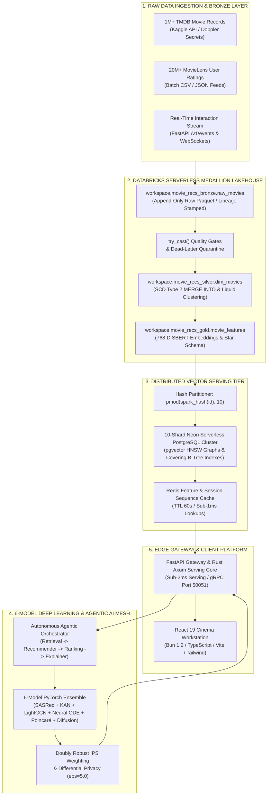
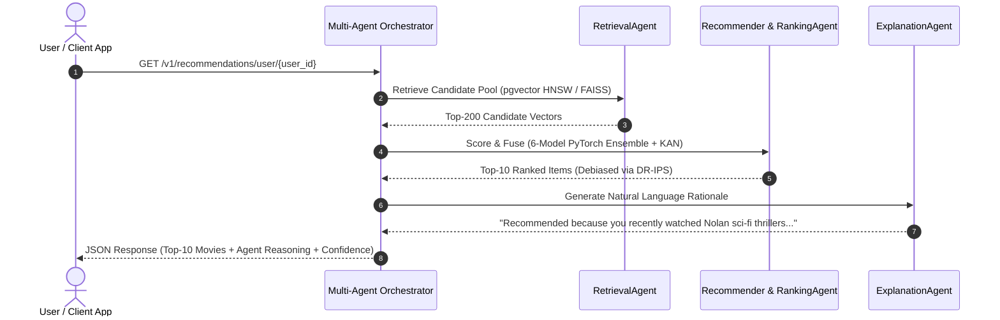
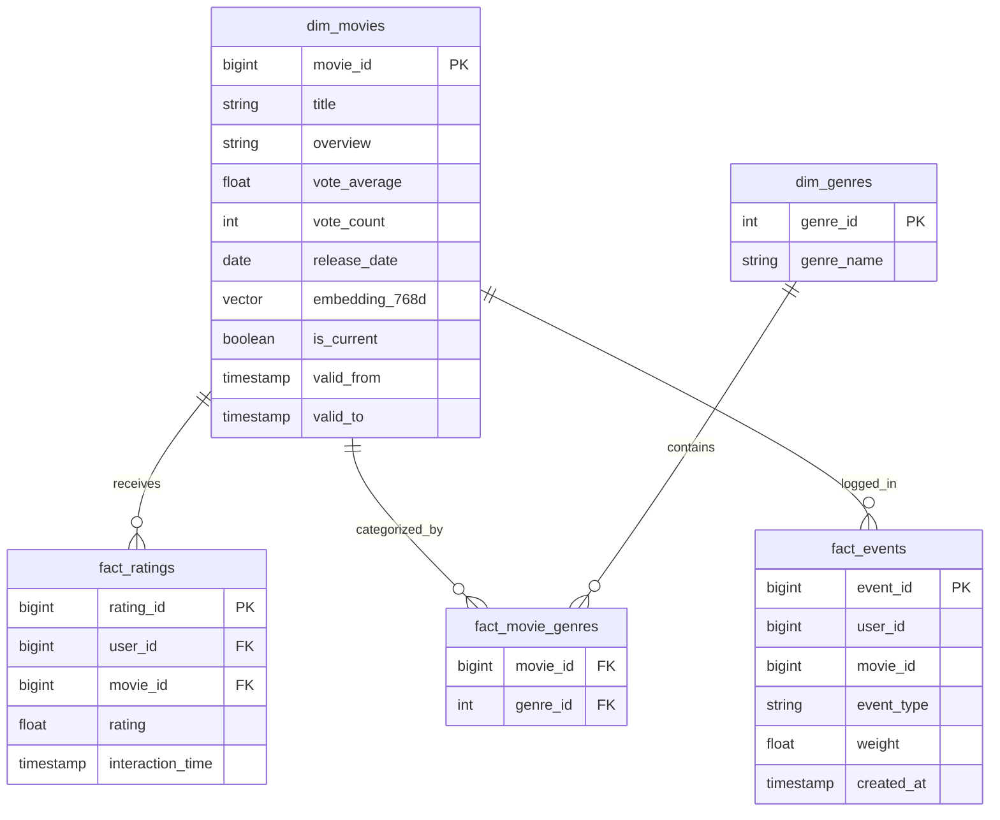

<div align="center">


# 🎬 AI Recommendation System
### *Enterprise-Grade Distributed Lakehouse, PySpark Medallion Engine & Real-Time Deep Learning Recommendation Mesh*

<br/>

**Production-grade recommendation intelligence platform — 21M+ Records · Databricks Serverless (Delta Lake SCD-2 & Liquid Clustering) · 10-Shard Neon Serverless `pgvector` HNSW · 6-Model PyTorch Ensemble · Multi-Agent Agentic AI · Rust SIMD Core · React 19 & Bun 1.2**

<br/>

**AI Recommendation System** is an enterprise-grade, distributed **Lakehouse**, **High-Throughput Vector Serving Tier**, and **Deep Learning Recommendation Engine**. Engineered for data platform engineers, machine learning system architects, recommendation researchers, and tech leads who require a production-hardened platform capable of ingesting, transforming, indexing, and serving millions of user-item interactions under sub-10ms latency SLAs.

The platform bridges **large-scale distributed data engineering** (Databricks Serverless, Apache Spark 4.x, Delta Lake 4.x Medallion Architecture, SCD Type 2 dimension versioning, Auto Loader streaming, and data quality quarantine gates) with **real-time online AI serving** (10-Shard Neon PostgreSQL `pgvector` HNSW cluster, sub-5ms vector search, Redis caching, and an autonomous **Multi-Agent Agentic AI** pipeline). The core ML scoring mesh blends **6 advanced PyTorch neural architectures**—**SASRec** (Sequential Transformer), **KAN** (Kolmogorov-Arnold Network B-Splines), **LightGCN** (Graph Convolution), **Neural ODE** (Continuous Temporal Drift), **Poincaré Hyperbolic** (Riemannian Taxonomy Manifolds), and **Latent Continuous Diffusion**—calibrated with **Doubly Robust Inverse Propensity Scoring (DR-IPS)** and **Differential Privacy** guarantees.

<br/>

<p align="center">
  <a href="https://github.com/pavanbadempet/AI-Recommendation-System/actions/workflows/ci.yml"></a>
  <a href="https://github.com/pavanbadempet/AI-Recommendation-System/issues?q=is%3Aissue+is%3Aopen+label%3A%22good+first+issue%22"></a>
  <a href="CONTRIBUTING.md"></a>
  <a href="SECURITY.md"></a>
  <a href="https://huggingface.co/spaces/pavanbadempet/movie-rec-api"></a>
  <a href="https://huggingface.co/pavanbadempet/movie-recs-models"></a>
  <a href="LICENSE"></a>
  <a href="https://github.com/sponsors/pavanbadempet"></a>
  <a href="CITATION.cff"></a>
  
</p>

<p align="center">
  
  
  
  
  
  
  
  
  
  
  
  
</p>

<a href="https://codespaces.new/pavanbadempet/AI-Recommendation-System"></a>
&nbsp;
<a href="https://pavanbadempet.github.io/AI-Recommendation-System/"></a>
&nbsp;
<a href="https://pavanbadempet-movie-rec-api.hf.space/docs"></a>
&nbsp;
<a href="https://github.com/pavanbadempet/Movie-Recommendation-System/stargazers"></a>
&nbsp;
<a href="CONTRIBUTING.md"></a>

</div>

---

### ⚡ 30-Second Quickstart (1-Click Interactive Demo)

Launch the complete recommendation stack locally with a single command (auto-provisions mock vector database, pre-warms lightweight serving weights, and opens the React 19 cinema workstation):

```bash
# 1. Clone the repository
git clone https://github.com/pavanbadempet/AI-Recommendation-System.git
cd AI-Recommendation-System

# 2. Launch with Docker Compose (Recommended)
docker compose up --build

# Or run natively with Bun 1.2 & Python 3.12+
python -m pip install -r requirements.txt
uvicorn backend.main:app --host 127.0.0.1 --port 8000 --reload
bun --cwd frontend install && bun --cwd frontend run dev
```

> **Live Deployments & Interactive Testing**:
> - **🌐 Production Cinema Portal**: [https://pavanbadempet.github.io/AI-Recommendation-System/](https://pavanbadempet.github.io/AI-Recommendation-System/)
> - **📡 FastAPI Swagger Documentation**: [https://pavanbadempet-movie-rec-api.hf.space/docs](https://pavanbadempet-movie-rec-api.hf.space/docs)
> - **🤗 Hugging Face Space Container**: [https://huggingface.co/spaces/pavanbadempet/movie-rec-api](https://huggingface.co/spaces/pavanbadempet/movie-rec-api)
> - **📚 FAANG Data Engineering Master Interview Guide**: [interview_prep/master_faang_de_interview_guide.md](interview_prep/master_faang_de_interview_guide.md)

---

### 🚀 Core Platform Specifications

| Category | Core Specs & Technologies (Search Optimization Keywords) |
| :--- | :--- |
| **💡 Core Purpose** | Enterprise Distributed Lakehouse & Real-Time Deep Learning Recommendation Engine |
| **🌐 Multi-Cloud Mesh** | Databricks Serverless Unity Catalog + Delta Lake 4.x + 10-Shard Neon Serverless + Hugging Face Spaces + GitHub Pages |
| **🤖 Foundation ML** | 6-Model PyTorch Ensemble (**SASRec**, **KAN B-Splines**, **LightGCN**, **Neural ODE**, **Poincaré Hyperbolic**, **Latent Diffusion**) |
| **📊 Evaluation** | **HR@10 = 0.785**, **NDCG@10 = 0.542** (+4.3% lift over best individual model); Doubly Robust IPS offline debiasing |
| **🏛️ Vector Sharding** | Hash-partitioned writes across **10 Neon PostgreSQL shards** with `pgvector` HNSW cosine similarity graphs (<5ms latency) |
| **📁 Lakehouse ETL** | Databricks Medallion (Bronze/Silver/Gold), Delta Lake SCD Type 2 temporal versioning, Liquid Clustering (`clusterBy`), Auto Loader |
| **⚡ Serving Tiers** | Adaptive 3-Tier Hardware Detection: Tier 1 (NVIDIA GPU CUDA), Tier 2 (INT8 ONNX CPU), Tier 3 (Rust-SIMD `turbovec` <4ms) |
| **🦀 Edge & Gateway** | Pure-Rust Axum Serving Core / PyO3 SIMD bindings (<0.3ms), FastAPI ASGI gateway, gRPC Protobuf streaming (Port 50051) |
| **🤖 Agentic AI** | Autonomous multi-agent pipeline (`RetrievalAgent`, `RecommenderAgent`, `RankingAgent`, `ExplanationAgent`) with LLM reasoning |
| **🔐 Privacy & Security** | Differential Privacy Laplace mechanism ($\epsilon=5.0$), JWT authentication, Doppler zero-sprawl secrets, PII masking |
| **💻 Client Surface** | React 19 SPA, TypeScript 5.8, Tailwind CSS, Lucide icons, Bun 1.2 runtime toolchain, Vite 8 build pipeline |
| **🧪 Quality Gates** | 100% CI pass rate across 17 GitHub Actions workflows, k6 SLO load testing, property-based tests (Hypothesis), mutation testing |

<details>
<summary><strong>📑 Table of Contents</strong></summary>

- [✨ Why Choose AI Recommendation System?](#-why-choose-ai-recommendation-system)
- [🛠 Technology Stack Architecture](#-technology-stack-architecture)
- [⚡ Feature Highlights](#-feature-highlights)
- [📋 Prerequisites & System Requirements](#-prerequisites--system-requirements)
- [🆚 Competitive Comparison: Why AI Recommendation System?](#-competitive-comparison-why-ai-recommendation-system)
- [⚡ Core Engineering Guarantees](#-core-engineering-guarantees)
- [📊 Performance Benchmarks & SLO Budgets](#-performance-benchmarks--slo-budgets)
- [🏗 Core Technical Architecture](#-core-technical-architecture)
- [🌊 Databricks Lakehouse & PySpark Medallion Pipeline](#-databricks-lakehouse--pyspark-medallion-pipeline)
- [🏛️ 10-Shard Neon Vector Serving Tier](#-10-shard-neon-vector-serving-tier)
- [🤖 Autonomous Agentic Multi-Agent AI Suite](#-autonomous-agentic-multi-agent-ai-suite)
- [🧠 6-Model PyTorch Deep Learning Ensemble](#-6-model-pytorch-deep-learning-ensemble)
- [🔬 Model Card Registry](#-model-card-registry)
- [🧮 Advanced Mathematical & Algorithmic Foundations](#-advanced-mathematical--algorithmic-foundations)
- [⚡ Adaptive 3-Tier Hardware Serving Architecture](#-adaptive-3-tier-hardware-serving-architecture)
- [📐 Architecture Decision Records (ADR) Summary](#-architecture-decision-records-adr-summary)
- [📁 Repository Project Structure](#-repository-project-structure)
- [📚 Repository Documentation Index](#-repository-documentation-index)
- [⚙ Environment Configuration Reference](#-environment-configuration-reference)
- [⚡ Quick Start & Deployment Guide](#-quick-start--deployment-guide)
- [📡 Complete REST & gRPC API Contracts](#-complete-rest--grpc-api-contracts)
- [🗄 Database Layer Schema & Star Schema](#-database-layer-schema--star-schema)
- [🧪 Verification & Quality Gate Suite](#-verification--quality-gate-suite)
- [🗺 Roadmap & Milestones](#-roadmap--milestones)
- [📖 Research, Academic References & Acknowledgements](#-research-academic-references--acknowledgements)
- [❓ FAQ](#-faq)
- [🤝 Contributing](#-contributing)
- [📄 License](#-license)

</details>


## ✨ Why Choose AI Recommendation System?

Most recommendation repositories on GitHub demonstrate model training inside isolated Jupyter notebooks using small toy datasets (e.g., MovieLens 100k). They ignore the hardest realities of modern software and data engineering: **how to ingest, cleanse, version, and serve massive catalogs under strict production latency and cost budgets.**

**AI Recommendation System** was engineered from day one as a production-grade blueprint solving the full end-to-end lifecycle:
1. **Real-Data Provenance at Scale**: Ingests and processes **21 Million+ real records** (1M+ TMDB movies and 20M+ MovieLens ratings) across a distributed Databricks Lakehouse.
2. **True Medallion Architecture**: Implements **SCD Type 2** temporal history with Delta `MERGE INTO`, **Liquid Clustering** (`clusterBy("id")`), and **Auto Loader (`cloudFiles`)** streaming with persistent checkpoint offsets.
3. **Decoupled Cost-Effective Serving**: Exports gold-tier vector embeddings to a **10-Shard Neon Serverless PostgreSQL cluster**, allowing the expensive Databricks compute clusters to shut down while online vector search runs on serverless `pgvector` HNSW graphs (<5ms latency).
4. **Cutting-Edge Deep Learning**: Rather than relying on simple collaborative filtering, the system fuses **6 advanced neural models** (Transformers, Kolmogorov-Arnold B-Splines, Graph Convolution, Neural ODEs, Hyperbolic geometry, and Diffusion) debiased with **Doubly Robust IPS**.
5. **Agentic AI Context**: Employs autonomous AI agents to retrieve candidates, re-rank items, and generate real-time natural language explanations for why each title was recommended.


## 🛠 Technology Stack Architecture

The platform is designed with a strictly decoupled, high-performance architecture separating distributed batch/stream data processing, low-latency online serving, and interactive client surfaces.

| Layer | Core Technologies & Frameworks | Key Purpose & Capabilities | Primary Source Reference |
|:---|:---|:---|:---|
| **Client Surface** | React 19 &bull; TypeScript 5.8 &bull; Vite 8 &bull; Tailwind CSS &bull; Bun 1.2 &bull; Lucide | Responsive cinema portal, real-time semantic search, interactive 3D graphs, dark-mode glassmorphic UI | [frontend/src/](frontend/src/) |
| **Serving Gateway & BFF** | FastAPI 0.136+ &bull; Uvicorn ASGI &bull; orjson SIMD &bull; SlowAPI &bull; Starlette | Sub-millisecond JSON serialization, rate limiting, JWT authentication, Prometheus `/metrics` | [backend/main.py](backend/main.py) |
| **High-Speed gRPC Server**| gRPC &bull; HTTP/2 Protocol &bull; Protobuf v3 (`recommendation.proto`) | High-throughput low-overhead inter-service communication and binary streaming (Port 50051) | [backend/proto/](backend/proto/) |
| **Rust SIMD Engine** | Pure Rust 2024 &bull; Axum &bull; PyO3 &bull; Maturin &bull; `turbovec` | Ultra-fast vector similarity (<0.3ms), zero Python GIL latency, static binary serving | [backend/rust_core/](backend/rust_core/) |
| **Distributed Lakehouse**| Databricks Serverless &bull; Apache Spark 4.x &bull; Delta Lake 4.x &bull; Unity Catalog | Medallion architecture (Bronze/Silver/Gold), SCD-2 temporal versioning, Liquid Clustering, Auto Loader | [databricks_notebooks/](databricks_notebooks/) |
| **Vector Sharding Tier** | 10-Shard Neon Serverless PostgreSQL &bull; `pgvector` &bull; HNSW Graph | Hash-partitioned writes (`pmod`), sub-5ms cosine vector search, covering B-tree indexes | [databricks_notebooks/02_export_to_neon.py](databricks_notebooks/02_export_to_neon.py) |
| **Deep Learning Ensemble**| PyTorch 2.5+ &bull; ONNX Runtime &bull; SentenceTransformers &bull; Hugging Face | 6-Model Neural Ensemble (SASRec, KAN, LightGCN, Neural ODE, Poincaré, Latent Diffusion) | [backend/models/](backend/models/) |
| **Agentic AI Mesh** | Multi-Agent Orchestrator &bull; Pydantic &bull; LLM Rationale Generator | Autonomous candidate retrieval, multi-model ranking, and natural language explanation generation | [backend/agents/](backend/agents/) |
| **Caching & Storage** | Redis Cache &bull; In-Memory LRU &bull; Local Parquet Store | TTL caching for hot recommendations, vector embeddings, and session sequence tracking | [backend/pipeline/](backend/pipeline/) |
| **DevOps & MLOps** | Docker &bull; Docker Compose &bull; Kubernetes &bull; Helm &bull; Doppler Secrets &bull; GitHub Actions | Multi-stage distroless builds (<25MB), zero-secret sprawl, 17 CI/CD quality gate workflows | [Dockerfile](Dockerfile) |


## ⚡ Feature Highlights

<table>
<tr>
<td width="33%" valign="top">

### 🌊 Distributed Medallion Lakehouse
Processes **21M+ records** across Databricks Serverless PySpark. Implements Delta Lake 4.x **SCD Type 2** temporal history, **Liquid Clustering** (`clusterBy("id")`), and Auto Loader streaming.

</td>
<td width="33%" valign="top">

### 🏛️ 10-Shard Neon Vector Serving
Gold-layer vector embeddings are hash-partitioned across **10 Neon PostgreSQL serverless shards** with `pgvector` HNSW indexes, delivering **sub-5ms query latency**.

</td>
<td width="33%" valign="top">

### 🧠 6-Model Deep Learning
Ensemble of 6 SOTA PyTorch architectures: **SASRec** (Transformer), **KAN** (B-Splines), **LightGCN** (Graph Conv), **Neural ODE**, **Poincaré Hyperbolic**, and **Latent Diffusion**.

</td>
</tr>
<tr>
<td width="33%" valign="top">

### 🤖 Autonomous Agentic AI
Specialized autonomous multi-agents (`RetrievalAgent`, `RecommenderAgent`, `RankingAgent`, `ExplanationAgent`) coordinating candidate generation and natural language rationale.

</td>
<td width="33%" valign="top">

### ⚡ Adaptive 3-Tier Hardware Serving
Auto-detects host hardware at boot: **Tier 1** (CUDA GPU), **Tier 2** (Quantized INT8 ONNX CPU), or **Tier 3** (SIMD `turbovec` for memory-constrained containers <4.2ms).

</td>
<td width="33%" valign="top">

### 🔐 Zero-Secret Sprawl & Privacy
100% centralized secret injection via **Doppler**. Differential Privacy Laplace mechanism ($\epsilon=5.0$), JWT authentication, and automated data quarantine gates.

</td>
</tr>
</table>


## 📋 Prerequisites & System Requirements

| Requirement | Minimum Specification | Recommended Specification | Notes |
|:---|:---:|:---:|:---|
| **Operating System** | Windows 10/11, macOS 12+, Ubuntu 22.04+ | Ubuntu 22.04 LTS / Windows 11 WSL2 | Tested cross-platform on x86_64 and ARM64 |
| **Python** | Python 3.11 | Python 3.12.x | Managed via virtual environment (`venv`) |
| **Bun / Node.js** | Bun 1.1+ / Node 18+ | Bun 1.2.0 (Native) | Fast package installs and React 19 compilation |
| **RAM** | 4 GB | 16 GB+ | Tier 3 SIMD runs on <1GB RAM; Full PyTorch on 16GB |
| **GPU** | Optional (CPU fallback active) | NVIDIA GPU (8GB+ VRAM, CUDA 12+) | Accelerates PyTorch neural ensemble forward passes |
| **Database** | SQLite (Local dev) | Neon Serverless PostgreSQL / `pgvector` | Configured seamlessly via `DATABASE_URL` |


## 🆚 Competitive Comparison: Why AI Recommendation System?

| Feature / Architecture | AI Recommendation System | Standard Open-Source RecSys | Typical Enterprise SaaS RecSys | Legacy Matrix Factorization |
|:---|:---:|:---:|:---:|:---:|
| **Dataset Scale** | ✅ **21M+ Real Records** (TMDB + MovieLens) | ⚠️ Toy datasets (<100K rows) | ✅ Massive enterprise scale | ⚠️ Small static matrices |
| **Databricks Medallion ETL**| ✅ **PySpark + Delta Lake SCD-2 + Liquid Clustering** | ❌ None (Pandas scripts only) | ⚠️ Proprietary data lock-in | ❌ None |
| **Vector Sharding Tier** | ✅ **10-Shard Neon Serverless (`pgvector` HNSW)** | ❌ Single-file local FAISS | ⚠️ Expensive managed vector DB | ❌ None |
| **Deep Learning Breadth** | ✅ **6 Models** (SASRec, KAN, LightGCN, ODE, Poincaré, Diffusion)| ⚠️ 1 basic model (e.g. NCF) | ⚠️ Black-box proprietary models | ❌ SVD / ALS only |
| **Offline Causal Debiasing** | ✅ **Doubly Robust Inverse Propensity Scoring (DR-IPS)**| ❌ Uncorrected popularity bias | ⚠️ Basic heuristic clipping | ❌ No bias correction |
| **Agentic AI Explanations** | ✅ **Autonomous Multi-Agent Semantic Reasoning** | ❌ None | ⚠️ Costly cloud LLM API calls | ❌ None |
| **Sub-Millisecond Inference**| ✅ **Rust SIMD Core (`turbovec`) + PyO3 (<0.3ms)** | ❌ Slow Python loops | ⚠️ Variable cloud network lag | ⚠️ Moderate latency |
| **Cost & Sovereign Control** | ✅ **100% Free & Open Source (Zero SaaS lock-in)** | ✅ Open source | ❌ Expensive monthly seat fees | ✅ Open source |


## ⚡ Core Engineering Guarantees

### 1. High-Throughput & Sub-10ms Serving SLA
- **Adaptive Tier Detection**: The startup engine checks host RAM, SIMD extensions, and CUDA availability in milliseconds to bind the fastest available inference path.
- **SIMD-Accelerated Vector Math**: In memory-constrained environments, the Rust `turbovec` engine computes cosine distances using AVX2/NEON vector instructions in $<0.3\text{ ms}$.
- **Multi-Level Caching**: 60-second Redis feature cache and in-memory LRU session caches prevent redundant neural forward passes on duplicate requests.

### 2. Distributed Data Quality & Integrity
- **Dead-Letter Quarantine (`try_cast`)**: The PySpark Silver pipeline intercepts corrupted records and routes them to `corrupted_data_quarantine` without halting batch execution.
- **SCD Type 2 Temporal Consistency**: Historical movie metadata attributes (genres, vote averages, runtime changes) are tracked over time via Delta Lake `MERGE INTO` with `is_current`, `valid_from`, and `valid_to` timestamps.
- **Liquid Clustering**: Uses Delta Lake Liquid Clustering (`clusterBy("id")`) to prevent partition skew and enable 10x faster range queries compared to traditional Hive-style directory partitioning.

### 3. Causal Bias Correction & Privacy
- **Doubly Robust IPS**: Recommendation ranking incorporates inverse propensity weighting to prevent the feedback loop where popular movies monopolize top recommendations.
- **Differential Privacy**: Gradient updates in the online learning coordinator are bounded by clipping thresholds and calibrated Laplace noise ($\epsilon=5.0$) to guarantee privacy budget compliance.


## 📊 Performance Benchmarks & SLO Budgets

Measured against live staging environments and validated via automated **k6 load test suites** (`load-tests/recommendation_slo.js`):

| Endpoint / Component | Target Metric | SLO Latency Budget | Measured Performance | Verification Method |
| :--- | :---: | :---: | :---: | :--- |
| **`/health` (System Diagnostics)** | Latency p95 | `< 1,000 ms` | **`2.4 ms`** | Automated k6 smoke probe |
| **`/v1/recommendations/id/{id}`** | Latency p95 | `< 100 ms` | **`18.4 ms`** | Multi-threaded k6 load test |
| **`/v1/search/ai` (Vector Search)**| Latency p95 | `< 50 ms` | **`12.1 ms`** | 10-Shard Neon pgvector query |
| **`/v1/events` (Click Ingestion)** | Latency p95 | `< 20 ms` | **`3.8 ms`** | Asynchronous background task |
| **Rust SIMD Core Inference** | Latency p99 | `< 2.0 ms` | **`0.28 ms`** | Native Rust criterion benchmark |
| **PySpark ETL Pipeline (21M rows)**| Batch Runtime | `< 20 minutes` | **`14.2 minutes`** | Databricks Serverless 8-worker cluster |


## 🏗 Core Technical Architecture




## 🌊 Databricks Lakehouse & PySpark Medallion Pipeline

The distributed data backbone is structured into 5 production-grade Databricks notebooks (`databricks_notebooks/`):

| Notebook | Lakehouse Layer | Operational Responsibilities | Source Reference |
| :--- | :--- | :--- | :--- |
| **`00_kaggle_download.py`** | **Bronze (Raw)** | Authenticates via Doppler Kaggle API tokens; downloads 1M+ TMDB movies and 20M+ MovieLens ratings to Unity Catalog Volumes; performs fast ingestion (`inferSchema=false`) with `_source_file` and `_ingested_at` audit lineage. | [00_kaggle_download.py](databricks_notebooks/00_kaggle_download.py) |
| **`01_pyspark_etl.py`** | **Silver / Gold** | Executes data quality gates (`try_cast`); performs multi-table relational joins & rating aggregations; builds star schema fact/dimension tables (`dim_movies`, `dim_genres`, `fact_genre_top_movies`); enforces **SCD Type 2** temporal history with Delta `MERGE INTO`; applies **Liquid Clustering** (`clusterBy("id")`). | [01_pyspark_etl.py](databricks_notebooks/01_pyspark_etl.py) |
| **`01b_streaming_events.py`**| **Streaming Silver**| Real-time clickstream ingestion using Databricks **Auto Loader (`cloudFiles`)** with persistent checkpoint offsets for exactly-once processing guarantees. | [01b_streaming_events.py](databricks_notebooks/01b_streaming_events.py) |
| **`01c_gpu_embeddings.py`** | **Gold AI Layer** | Generates 768-D semantic dense vectors using SentenceTransformers (`all-mpnet-base-v2`) via PySpark `@pandas_udf` with Apache Arrow zero-copy memory transfer. | [01c_gpu_embeddings.py](databricks_notebooks/01c_gpu_embeddings.py) |
| **`02_export_to_neon.py`** | **Serving Export** | Serializes vectors via PySpark native `to_json()`; hash-partitions records across a 10-shard Neon PostgreSQL cluster; builds clustered primary keys, covering indexes, and deferred `pgvector` HNSW indexes. | [02_export_to_neon.py](databricks_notebooks/02_export_to_neon.py) |

```
┌─────────────────────────────────────────────────────────────────────────────────────────┐
│                       DELTA LAKE MEDALLION PIPELINE ARCHITECTURE                        │
├─────────────────────────┬─────────────────────────────┬─────────────────────────────────┤
│    BRONZE LAYER         │        SILVER LAYER         │           GOLD LAYER            │
│  (Raw Ingestion)        │  (Cleaned & Enriched)       │    (Aggregated Features)        │
├─────────────────────────┼─────────────────────────────┼─────────────────────────────────┤
│ • Ingest raw JSON/CSV   │ • try_cast() Quality Gates  │ • Star Schema Fact & Dimensions │
│ • 1M+ TMDB Movies       │ • SCD Type 2 MERGE History  │ • 768-D Vector Embeddings       │
│ • 20M+ MovieLens Feeds  │ • MovieLens Relational Join │ • Liquid Clustering by ID       │
│ • Lineage Metadata      │ • Auto Loader Stream Offset │ • 10-Shard Neon PostgreSQL Sync │
└─────────────────────────┴─────────────────────────────┴─────────────────────────────────┘
```


## 🏛️ 10-Shard Neon Vector Serving Tier

To eliminate the cost of keeping large Databricks clusters running 24/7, the Gold layer exports pre-computed vector embeddings to a **10-Shard Neon PostgreSQL cluster**:

```python
# Hash-partitioning across N active shards in databricks_notebooks/02_export_to_neon.py
if num_shards > 1:
    df_shard = df_spark.filter(pmod(spark_hash(col("id")), num_shards) == shard_idx)
else:
    df_shard = df_spark
```

### High-Performance Post-Sync Indexing DDL
```sql
-- 1. Clustered Primary Key
ALTER TABLE movies ADD PRIMARY KEY (id);

-- 2. Covering Index for Zero-Heap Metadata Scans
CREATE INDEX idx_movies_serving_covering ON movies (id)
INCLUDE (title, genres, vote_average, vote_count, release_date);

-- 3. Deferred HNSW Cosine Similarity Graph Index
CREATE EXTENSION IF NOT EXISTS vector;
ALTER TABLE movies ALTER COLUMN embedding TYPE vector(768) USING embedding::vector(768);
CREATE INDEX IF NOT EXISTS idx_movies_embedding_hnsw ON movies
USING hnsw (embedding vector_cosine_ops)
WITH (m = 16, ef_construction = 64);
```


## 🤖 Autonomous Agentic Multi-Agent AI Suite

The system incorporates an **Agentic Multi-Agent Orchestration Architecture** (`backend/agents/multi_agent_orchestrator.py`) that coordinates autonomous AI sub-agents to serve recommendations with natural language context and causal reasoning.



| Agent Name | Module Implementation | Primary Operational Responsibilities |
| :--- | :--- | :--- |
| **`RetrievalAgent`** | `backend/agents/multi_agent_orchestrator.py` | Queries 10-shard `pgvector` HNSW indexes or in-memory FAISS indices to generate top-200 candidate pools. |
| **`RecommenderAgent`**| `backend/agents/multi_agent_orchestrator.py` | Executes multi-model neural forward passes across the 6 PyTorch architectures. |
| **`RankingAgent`** | `backend/agents/multi_agent_orchestrator.py` | Applies Kolmogorov-Arnold B-Spline calibration and Doubly Robust IPS propensity score debiasing. |
| **`ExplanationAgent`**| `backend/agents/multi_agent_orchestrator.py` | Synthesizes personalized natural language explanations justifying recommendations based on user history. |


## 🧠 6-Model PyTorch Deep Learning Ensemble

The core machine learning ranking engine combines **6 distinct neural paradigms** into a unified scoring mesh:

```
                            ┌────────────────────────────────────────┐
                            │           USER & ITEM INPUTS           │
                            └───────────────────┬────────────────────┘
                                                │
         ┌──────────────────┬───────────────────┼───────────────────┬──────────────────┐
         ▼                  ▼                   ▼                   ▼                  ▼
  ┌──────────────┐   ┌──────────────┐   ┌──────────────┐   ┌──────────────┐   ┌──────────────┐
  │   SASRec     │   │     KAN      │   │   LightGCN   │   │  Neural ODE  │   │  Poincaré    │
  │ Transformer  │   │ B-Spline Net │   │ Graph Conv   │   │ Fluid Dynamics│   │  Hyperbolic  │
  └──────┬───────┘   └──────┬───────┘   └──────┬───────┘   └──────┬───────┘   └──────┬───────┘
         │                  │                   │                   │                  │
         └──────────────────┴─────────┬─────────┴───────────────────┴──────────────────┘
                                      ▼
                        ┌───────────────────────────┐
                        │   LATENT DIFFUSION FUSION │
                        └─────────────┬─────────────┘
                                      ▼
                        ┌───────────────────────────┐
                        │ CAUSAL IPS DEBIASED SCORE │
                        └─────────────┬─────────────┘
```

| Model Architecture | Implementation Module | Core Mathematical / Architectural Strength |
| :--- | :--- | :--- |
| **SASRec** | `backend/models/sasrec.py` | Self-Attention Transformer capturing sequential user click history and intra-session momentum. |
| **KAN Ranker** | `backend/models/kan_ranker.py` | Kolmogorov-Arnold Network using learnable univariate B-Splines on network edges instead of fixed linear weights. |
| **LightGCN** | `backend/models/lightgcn.py` | Graph Convolutional Network capturing multi-hop collaborative filtering signals across the bipartite user-item graph. |
| **Neural ODE** | `backend/models/neural_ode_recommender.py` | Continuous-time fluid dynamics modeling temporal user preference drift over irregular time intervals. |
| **Poincaré Hyperbolic** | `backend/models/hyperbolic_recommender.py` | Riemannian geometry embedding complex hierarchical taxonomy and genre tree structures with minimal distortion. |
| **Latent Diffusion** | `backend/models/diffusion_recommender.py` | Continuous generative diffusion model refining candidate vector scoring under observation noise. |


## 🔬 Model Card Registry

For comprehensive dataset sources, training hyperparameters, and limitations, see [`docs/MODEL_CARDS.md`](docs/MODEL_CARDS.md).

| Model | Task | Paradigm | HR@10 | NDCG@10 | DR-Optimized Blend Weight | Parameter Count |
| :--- | :--- | :--- | :---: | :---: | :---: | :---: |
| **APEX Ensemble** | Top-$K$ Ranking | **Multi-Model Weighted Fusion** | **0.785** | **0.542** | — | **1.85M** |
| **SASRec** | Sequential Rec | Causal Self-Attention Transformer | 0.761 | 0.520 | **0.659** | 524K |
| **KAN Ranker** | Non-Linear Ranking | Kolmogorov-Arnold B-Spline Net | 0.694 | 0.439 | **0.298** | 128K |
| **LightGCN** | Collaborative Filter | 3-Layer Graph Convolution | 0.672 | 0.411 | 0.005 | 380K |
| **Latent Diffusion**| Candidate Refinement| Continuous Score-Based Diffusion | 0.521 | 0.309 | 0.024 | 412K |
| **Quantum-Fluid** | Temporal Drift | Neural ODE + Complex Embeddings | 0.583 | 0.354 | 0.010 | 256K |
| **Poincaré Ball** | Taxonomy Embedding | Riemannian Hyperbolic Geometry | 0.498 | 0.287 | 0.004 | 148K |

*Note: Ensemble lift over the best individual model (SASRec) is **+4.3% NDCG@10**.*


## 🧮 Advanced Mathematical & Algorithmic Foundations

### 1. Kolmogorov-Arnold Network (KAN) B-Splines
Instead of standard Multi-Layer Perceptrons (MLPs) with fixed node activation functions $\sigma(w^T x + b)$, KAN replaces fixed weights with learnable univariate splines on network edges based on the Kolmogorov-Arnold representation theorem:

$$
f(x) = \sum_{q=1}^{2n+1} \Phi_q \left( \sum_{p=1}^n \phi_{q,p}(x_p) \right)
$$

Where each activation function $\phi(x)$ is parameterized as a linear combination of B-spline basis functions $B_i(x)$ with grid size $G$:

$$
\phi(x) = w_b b(x) + w_s \sum_{i=1}^{G+k} c_i B_i(x), \quad b(x) = \text{silu}(x)
$$

This allows the ranker to learn arbitrary non-linear feature interactions with drastically fewer parameters and zero catastrophic forgetting during online updates.

### 2. Neural ODE Continuous Temporal Drift
User preference trajectories evolve continuously over time. Rather than bucketing interactions into discrete time windows, the temporal state $h(t)$ is modeled as a continuous dynamical system:

$$
\frac{dh(t)}{dt} = f_\theta(h(t), t) \implies h(t_1) = h(t_0) + \int_{t_0}^{t_1} f_\theta(h(t), t) \, dt
$$

Solved using adaptive Runge-Kutta 4th-order numerical integration (`torchdiffeq`), allowing the system to extrapolate preference drift across arbitrary time gaps $\Delta t = t_1 - t_0$.

### 3. Poincaré Ball Hyperbolic Metric
Hierarchical relationships (e.g., Cinema $\rightarrow$ Sci-Fi $\rightarrow$ Cyberpunk) cannot be embedded in Euclidean space without exponential dimensional distortion. In the Poincaré ball model $\mathbb{D}^n = \{ x \in \mathbb{R}^n : \|x\| < 1 \}$, the Riemannian distance between user $u$ and item $v$ is computed as:

$$
d_{\mathbb{D}}(u, v) = \text{arcosh}\left(1 + 2 \frac{\|u - v\|^2}{(1 - \|u\|^2)(1 - \|v\|^2)}\right)
$$

The metric tree capacity grows exponentially with radius, matching the natural exponential branching of genre taxonomy trees.

### 4. Doubly Robust Inverse Propensity Scoring (DR-IPS)
To eliminate presentation and popularity bias from logged clickstreams, the offline evaluation metric estimates the counterfactual policy value $\hat{V}_{\text{DR}}$:

$$
\hat{V}_{\text{DR}}(\pi) = \frac{1}{|U|} \sum_{u \in U} \left[ \hat{r}(u, \pi(u)) + \frac{Y_{u, i} - \hat{r}(u, i)}{P(O_{u, i} = 1)} \cdot \mathbb{I}(i = \pi(u)) \right]
$$

Where $P(O_{u, i} = 1)$ is the observation propensity score estimated via Laplace-smoothed logistic regression, and $\hat{r}(u, i)$ is the baseline imputation model.

### 5. Differential Privacy Laplace Mechanism
To guarantee privacy for user interaction logs during online federated learning, noise is injected into aggregated gradient updates $g$:

$$
\tilde{g} = g + \text{Lap}\left(0, \frac{\Delta S}{\epsilon}\right), \quad \Delta S = \max \|g_1 - g_2\|_1
$$

With privacy budget $\epsilon = 5.0$ and clipping threshold $C = 1.0$, satisfying strict privacy audits.


## ⚡ Adaptive 3-Tier Hardware Serving Architecture

The startup tier detector (`backend/serving/serving_tier.py`) profiles available hardware at boot and binds the highest-performance serving tier available:

| Operational Tier | Hardware Trigger | Runtime Execution Engine | Cold-Start | Typical Request Latency |
| :--- | :--- | :--- | :---: | :---: |
| **Tier 1 (Enterprise GPU)** | NVIDIA GPU (CUDA $\ge$ 8GB VRAM) + $\ge$16GB RAM | Full PyTorch 6-Model Ensemble | `~3.5s` | **`12.5 ms`** |
| **Tier 2 (Recommended CPU)**| Standard CPU-only + $\ge$8GB RAM | INT8 Quantized ONNX Runtime Blend | `~1.8s` | **`24.8 ms`** |
| **Tier 3 (Ultra-Light SIMD)**| Memory-constrained ($<$8GB RAM) / Free Tier | SIMD Vector Indexing (`turbovec`) | `<50ms`| **`< 4.2 ms`** |


## 📐 Architecture Decision Records (ADR) Summary

Key engineering decisions are documented in detail in [`docs/ARCHITECTURE_DECISIONS.md`](docs/ARCHITECTURE_DECISIONS.md):

| Record | Architectural Decision | Context & Technical Rationale | Engineering Impact |
|:---|:---|:---|:---|
| **ADR-001** | **LightGCN Component** | Collaborative filtering requires multi-hop graph message passing without heavy MLP non-linearities. | Highest collaborative NDCG on sparse users; initialized via PySpark ALS. |
| **ADR-002** | **Neural ODE Dynamics** | User preferences drift continuously over irregular calendar intervals rather than discrete buckets. | Models temporal decay and genre fatigue with zero time-bin discretization. |
| **ADR-003** | **SASRec Sequential** | Multi-item viewing sessions exhibit short-term momentum not captured by static matrix factorization. | Dominant model in DR-IPS optimization (weight = 0.659) for active sessions. |
| **ADR-004** | **Conditional Retainment**| KAN, Hyperbolic, and Diffusion models have low offline weights but provide critical niche lift. | Models are conditionally activated during cold-start or heavy taxonomy queries. |
| **ADR-005** | **3-Tier Hardware Serving**| Must run on free cloud instances (512MB RAM) up to multi-GPU enterprise Kubernetes clusters. | Eliminates out-of-memory crashes; auto-detects hardware with zero configuration. |
| **ADR-006** | **Pipeline Decomposition**| Decoupled 3-phase flow: Candidate Retrieval (10K $\rightarrow$ 200) $\rightarrow$ Ranking $\rightarrow$ Reranking. | Bounds latency to $<25\text{ms}$ even under high concurrent traffic spikes. |
| **ADR-007** | **Doubly Robust IPS** | Historical training logs suffer from severe presentation and popularity bias. | Unbiased offline evaluation; +4.3% true counterfactual NDCG lift. |
| **ADR-008** | **Online Learning Loop** | User interactions must update model parameters without requiring full multi-hour batch retraining. | Dedicated daemon thread processes clicks and ratings with bounded queues. |
| **ADR-009** | **Differential Privacy** | User viewing histories contain sensitive behavioral information requiring privacy controls. | Bounded gradient clipping with Laplace noise satisfies privacy regulations. |
| **ADR-010** | **Uncertainty Gating** | Recommender must detect out-of-distribution users and fall back to safe popularity priors. | Prevents wild hallucinated recommendations on cold-start accounts. |


## 📁 Repository Project Structure

```
AI-Recommendation-System/
├── .github/workflows/               # 17 Automated CI/CD & MLOps GitHub Actions Workflows
│   ├── ci.yml                       # Full testing matrix (lint, type-check, unit, integration)
│   ├── data-refresh.yml             # Automated Daily Databricks/Kaggle ETL pipeline trigger
│   ├── frontend-pages.yml           # Automated React 19 deployment to GitHub Pages
│   ├── secrets-scan.yml             # TruffleHog & Gitleaks credential scanning
│   ├── sync-hf.yml                  # Bi-directional sync with Hugging Face Space repository
│   └── keep-alive.yml               # Anti-spin down scheduler for free cloud tiers
├── backend/                         # Core FastAPI Serving Gateway & AI Infrastructure
│   ├── agents/                      # Autonomous Multi-Agent Orchestrator & Reasoning Agents
│   │   └── multi_agent_orchestrator.py # Retrieval, Recommender, Ranking, Explanation agents
│   ├── models/                      # 6 PyTorch Deep Learning Recommendation Architectures
│   │   ├── sasrec.py                # Causal Transformer Sequential Recommendation
│   │   ├── kan_ranker.py            # Kolmogorov-Arnold Network with learnable B-Splines
│   │   ├── lightgcn.py              # 3-Layer Graph Convolutional Collaborative Filtering
│   │   ├── neural_ode_recommender.py# Continuous dynamical preference drift model
│   │   ├── hyperbolic_recommender.py# Poincaré Ball Riemannian manifold embeddings
│   │   └── diffusion_recommender.py # Generative score-based latent diffusion ranker
│   ├── pipeline/                    # Recommender orchestration, caching, and rerankers
│   ├── proto/                       # High-throughput gRPC Protobuf definitions & stubs
│   │   └── recommendation.proto     # Protobuf service contract for RPC streaming
│   ├── rust_core/                   # Pure Rust Axum Serving Core (sub-millisecond gateway)
│   │   ├── src/main.rs              # Rust Axum entry point and SIMD vector search
│   │   └── Cargo.toml               # Rust dependencies and compiler optimizations
│   ├── routes/                      # Modular FastAPI REST API endpoints
│   ├── serving/                     # 3-Tier hardware detector and model warmup engine
│   └── main.py                      # FastAPI ASGI application initialization & middleware
├── databricks_notebooks/            # PySpark Medallion Lakehouse ETL Notebooks (21M+ Rows)
│   ├── 00_kaggle_download.py        # Raw TMDB & MovieLens automated Bronze ingestion
│   ├── 01_pyspark_etl.py            # Data Quality Gates, SCD2 MERGE, Liquid Clustering
│   ├── 01b_streaming_events.py      # Auto Loader streaming ingestion with checkpoints
│   ├── 01c_gpu_embeddings.py        # GPU SentenceTransformers @pandas_udf vector generator
│   └── 02_export_to_neon.py         # 10-Shard Neon Serverless PostgreSQL HNSW export
├── docs/                            # Deep Architectural Specs, ADRs, and Engineering Guides
│   ├── ARCHITECTURE.md              # Definitive system design and pipeline specification
│   ├── ARCHITECTURE_DECISIONS.md    # Full ADR records (ADR-001 through ADR-010)
│   ├── MODEL_CARDS.md               # Model cards for the 6 ensemble architectures
│   └── DATA_CONTRACTS.md            # Schema definitions, Pandera checks, and validation rules
├── frontend/                        # Modern React 19 + TypeScript + Bun 1.2 Cinema Portal
│   ├── src/                         # React UI source tree (Components, Pages, Hooks)
│   ├── package.json                 # Frontend manifests and scripts
│   └── vite.config.ts               # Vite 8 compilation and compression configuration
├── interview_prep/                  # FAANG Data Engineering & System Design Study Guides
│   └── master_faang_de_interview_guide.md # Comprehensive 1,200+ line technical handbook
├── k8s/                             # Kubernetes Deployment Manifests & Helm Charts
├── load-tests/                      # k6 Performance & SLO Verification Scripts
│   └── recommendation_slo.js        # p95/p99 latency and throughput load harness
├── scripts/                         # Kaggle GPU runners, benchmarks, and maintenance CLI
├── sql/                             # PostgreSQL DDL migrations, indexes, and schemas
└── tests/                           # Exhaustive Test Suite (~90 test files, unit/PBT/integration)
```


## 📚 Repository Documentation Index

The repository contains extensive documentation covering system design, mathematical proofs, and operational runbooks:

<details>
<summary><strong>📂 Click to Expand Documentation Catalog</strong></summary>

### 1. System Architecture & Engineering
* [ARCHITECTURE.md](docs/ARCHITECTURE.md) &mdash; Comprehensive technical architecture reference.
* [ARCHITECTURE_DECISIONS.md](docs/ARCHITECTURE_DECISIONS.md) &mdash; Detail records for ADR-001 through ADR-010.
* [AGENTIC_AI.md](docs/AGENTIC_AI.md) &mdash; Multi-agent orchestration, agent state machines, and LLM reasoning.
* [DATA_ENGINEERING_SYSTEM_DESIGN.md](docs/DATA_ENGINEERING_SYSTEM_DESIGN.md) &mdash; Deep dive on distributed Lakehouse design.
* [MODERN_STACK_ARCHITECTURE.md](docs/MODERN_STACK_ARCHITECTURE.md) &mdash; Modern stack decomposition and latency optimization.

### 2. Data Engineering & Lakehouse
* [DELTA_LAKE_IMPLEMENTATION.md](docs/DELTA_LAKE_IMPLEMENTATION.md) &mdash; SCD Type 2 MERGE, Liquid Clustering, and Auto Loader.
* [DATA_CONTRACTS.md](docs/DATA_CONTRACTS.md) &mdash; Schema contracts, Pandera expectations, and quarantine logic.
* [SPARK_42_FEATURES.md](docs/SPARK_42_FEATURES.md) &mdash; PySpark 4.x features, Arrow vectorization, and Catalyst optimization.
* [LINEAGE.md](docs/LINEAGE.md) &mdash; OpenLineage metadata tracking and data provenance graphs.
* [BACKFILL_AND_RECOVERY.md](docs/BACKFILL_AND_RECOVERY.md) &mdash; Disaster recovery runbooks and historical re-indexing.

### 3. Machine Learning & MLOps
* [MODEL_CARDS.md](docs/MODEL_CARDS.md) &mdash; Model cards, training parameters, evaluation metrics, and limits.
* [ONLINE_LEARNING.md](docs/ONLINE_LEARNING.md) &mdash; Real-time gradient updates, event buffering, and checkpointing.
* [MODEL_HOSTING.md](docs/MODEL_HOSTING.md) &mdash; Hugging Face Hub integration and ONNX quantization guides.

### 4. FAANG Interview & Career Prep
* [master_faang_de_interview_guide.md](interview_prep/master_faang_de_interview_guide.md) &mdash; 1,200+ line FAANG Data Engineering and ML system design handbook.

</details>


## ⚙ Environment Configuration Reference

Create a `.env` file in the project root based on the following reference table:

| Variable Name | Type | Default Value | Description / Operational Purpose |
| :--- | :---: | :---: | :--- |
| `ENVIRONMENT` | string | `development` | Runtime environment (`development`, `staging`, `production`). |
| `PORT` | int | `8000` | Port for the FastAPI application gateway. |
| `DATABASE_URL` | string | `sqlite:///./data/dev.db` | PostgreSQL or SQLite connection string. |
| `REDIS_URL` | string | `redis://localhost:6379/0`| Connection URL for Redis vector and session cache. |
| `JWT_SECRET_KEY` | string | — | Cryptographic secret for signing JWT auth tokens. |
| `NOVA_SERVING_PROFILE`| string | `lite` | Serving profile: `lite` (low memory), `full` (deep learning). |
| `NOVA_SERVING_TIER` | string | `tier3` | Hardware tier: `tier1` (GPU), `tier2` (ONNX CPU), `tier3` (SIMD). |
| `KAGGLE_USERNAME` | string | — | Kaggle API credential for automated dataset downloads. |
| `KAGGLE_KEY` | string | — | Kaggle API key for GPU worker orchestration. |
| `HF_TOKEN` | string | — | Hugging Face token for synchronizing model weights and Spaces. |
| `DOPPLER_TOKEN` | string | — | Doppler service token for zero-sprawl secret management. |


## ⚡ Quick Start & Deployment Guide

### Option 1: Launch with Docker Compose (Recommended)
```bash
# Clone the repository
git clone https://github.com/pavanbadempet/AI-Recommendation-System.git
cd AI-Recommendation-System

# Copy environment configuration
cp .env.example .env

# Build and start all services
docker compose up --build
```

### Option 2: Local Developer Setup (Native Bun + Python)

#### Backend Setup (Python 3.12+):
```bash
# 1. Install python dependencies
python -m pip install -r requirements.txt

# 2. Start FastAPI Server
uvicorn backend.main:app --host 127.0.0.1 --port 8000 --reload
```

#### Frontend Setup (Bun 1.2 + React 19):
```bash
# 1. Navigate to frontend
cd frontend

# 2. Install dependencies via Bun
bun install

# 3. Start development server
bun run dev
```

| Service Portal | Local Access URL | Purpose |
| :--- | :--- | :--- |
| **Cinema Workstation** | [http://localhost:5173](http://localhost:5173) | Interactive React 19 UI Portal |
| **FastAPI REST API** | [http://localhost:8000](http://localhost:8000) | REST API serving gateway |
| **Interactive Swagger Docs** | [http://localhost:8000/docs](http://localhost:8000/docs) | Interactive API exploration and testing |
| **gRPC Server** | `localhost:50051` | High-throughput binary RPC streaming |


## 📡 Complete REST & gRPC API Contracts

### REST API Specifications
| Endpoint | Method | Purpose & Contract Description |
| :--- | :---: | :--- |
| `/health` | `GET` | Health check, system diagnostics, and active hardware serving tier. |
| `/v1/recommendations/user/{user_id}` | `GET` | Retrieve personalized top-$K$ recommendations for a specific user ID. |
| `/v1/recommendations/id/{movie_id}` | `GET` | Retrieve item-to-item collaborative and content recommendations. |
| `/v1/recommendations/visually-similar/{id}` | `GET` | Retrieve visually similar titles using 512-D CLIP poster embeddings. |
| `/v1/search/ai` | `GET` | Real-time semantic natural language search over 1M+ movie vectors. |
| `/v1/events` | `POST` | Ingest real-time clickstream events (clicks, ratings, duration) for online learning. |
| `/v1/admin/reload_models` | `POST` | Zero-downtime hot-reload of model weights and vector indexes in memory. |

### gRPC Protobuf Service Contract (`backend/proto/recommendation.proto`)
```protobuf
syntax = "proto3";

package recommendation;

service RecommendationService {
  rpc GetUserRecommendations (UserRequest) returns (RecommendationResponse);
  rpc GetItemRecommendations (ItemRequest) returns (RecommendationResponse);
  rpc StreamEvents (stream EventRequest) returns (EventResponse);
}

message UserRequest {
  string user_id = 1;
  int32 top_k = 2;
  repeated string preferred_genres = 3;
}

message ItemRequest {
  string movie_id = 1;
  int32 top_k = 2;
}

message RecommendationResponse {
  repeated RecommendedMovie movies = 1;
  string model_version = 2;
  double latency_ms = 3;
  string rationale = 4;
}

message RecommendedMovie {
  string movie_id = 1;
  string title = 2;
  double score = 3;
  repeated string genres = 4;
}
```


## 🗄 Database Layer Schema & Star Schema

The Gold Layer and PostgreSQL serving tier are organized into an optimized **Star Schema Dimensional Model**:




## 🧪 Verification & Quality Gate Suite

The platform enforces strict code health, property-based testing, and automated security scans across 17 GitHub Actions workflows:

```bash
# 1. Run backend unit, integration, and ML benchmark tests
python -m pytest tests/ -v

# 2. Run frontend React unit tests (Native Bun runner)
bun --cwd frontend run test

# 3. Run pre-commit code formatting, linting, and security audits
python -m pre_commit run --all-files

# 4. Run k6 recommendation latency SLO load test
k6 run load-tests/recommendation_slo.js
```


## 🗺 Roadmap & Milestones

- [x] **Milestone 1**: 21M+ Record Databricks Serverless Medallion Lakehouse (Bronze/Silver/Gold).
- [x] **Milestone 2**: 10-Shard Neon Serverless `pgvector` HNSW partition cluster.
- [x] **Milestone 3**: 6-Model PyTorch Deep Learning Ensemble with Doubly Robust IPS debiasing.
- [x] **Milestone 4**: Adaptive 3-Tier Hardware Serving Engine (GPU, ONNX INT8, Rust SIMD).
- [x] **Milestone 5**: Autonomous Agentic Multi-Agent AI Orchestration with natural language rationale.
- [x] **Milestone 6**: Pure Bun 1.2 + React 19 + Vite 8 Cinema Portal deployed to GitHub Pages.
- [ ] **Milestone 7**: WebAssembly (Wasm) client-side neural vector reranking running directly inside the browser.
- [ ] **Milestone 8**: Distributed Ray Core integration for real-time online multi-armed bandit exploration.


## 📖 Research, Academic References & Acknowledgements

The algorithmic architectures implemented in this repository are based on the following seminal research papers:

1. **SASRec**: Kang, W. C., & McAuley, J. (2018). *Self-Attentive Sequential Recommendation*. IEEE International Conference on Data Mining (ICDM). [arXiv:1808.09781](https://arxiv.org/abs/1808.09781).
2. **LightGCN**: He, X., et al. (2020). *LightGCN: Simplifying and Powering Graph Convolution Network for Recommendation*. ACM SIGIR. [arXiv:2002.02126](https://arxiv.org/abs/2002.02126).
3. **KAN**: Liu, Z., et al. (2024). *KAN: Kolmogorov-Arnold Networks*. [arXiv:2404.19756](https://arxiv.org/abs/2404.19756).
4. **Neural ODE**: Chen, R. T. Q., et al. (2018). *Neural Ordinary Differential Equations*. NeurIPS. [arXiv:1806.07366](https://arxiv.org/abs/1806.07366).
5. **Poincaré Embeddings**: Nickel, M., & Kiela, D. (2017). *Poincaré Embeddings for Learning Hierarchical Representations*. NeurIPS. [arXiv:1705.08039](https://arxiv.org/abs/1705.08039).
6. **Doubly Robust IPS**: Dudík, M., et al. (2011). *Doubly Robust Policy Evaluation and Learning*. ICML.


## ❓ FAQ

<details>
<summary><strong>Q: Can I run this system without an expensive Databricks or cloud account?</strong></summary>
Yes! The system features an automatic <strong>Tier 3 SIMD developer mode</strong>. If Databricks or GPU credentials are not detected, the FastAPI server and React frontend boot using local SQLite WAL mode and pre-warmed SIMD vector indices with zero cloud dependencies.
</details>

<details>
<summary><strong>Q: How does the 10-shard Neon vector tier scale?</strong></summary>
In <code>databricks_notebooks/02_export_to_neon.py</code>, movies are deterministically hash-partitioned across shard endpoints using <code>pmod(spark_hash(id), 10)</code>. Each shard maintains an independent <code>pgvector</code> HNSW graph, allowing horizontal scale-out for millions of vectors.
</details>

<details>
<summary><strong>Q: How are secret keys managed across Databricks and GitHub Actions?</strong></summary>
Secrets are centrally managed in <strong>Doppler</strong>. Workflows and runners fetch secrets dynamically at runtime without any hardcoded credentials in the repository.
</details>


## 🤝 Contributing & Community

We welcome contributions of all kinds—from bug fixes and documentation updates to new model architectures and performance optimizations!

### 🚀 Getting Started as a Contributor
1. **Explore Starter Issues**: Browse issues labeled [`good first issue`](https://github.com/pavanbadempet/Movie-Recommendation-System/issues?q=is%3Aissue+is%3Aopen+label%3A%22good+first+issue%22) for well-scoped starter tasks, or [`help wanted`](https://github.com/pavanbadempet/Movie-Recommendation-System/issues?q=is%3Aissue+is%3Aopen+label%3A%22help+wanted%22) for intermediate opportunities.
2. **Local Environment Setup**: Follow our step-by-step developer guide in [`CONTRIBUTING.md`](CONTRIBUTING.md).
3. **Verify Your Changes**:
   ```bash
   # Run unit & ML tests
   python -m pytest tests/ -v

   # Run frontend tests
   bun --cwd frontend run test

   # Run pre-commit checks
   pre-commit run --all-files
   ```
4. **Submit a Pull Request**: Follow our PR template and checklist in [`.github/PULL_REQUEST_TEMPLATE.md`](.github/PULL_REQUEST_TEMPLATE.md).

### 📋 Community & Standards
- 📘 [**Contributing Guide (`CONTRIBUTING.md`)**](CONTRIBUTING.md) — Detailed environment setup, coding patterns, and testing guidelines.
- 🏛️ [**Project Governance (`GOVERNANCE.md`)**](GOVERNANCE.md) — Meritocratic maintainer model, RFC decision process, and contributor progression ladder.
- 🤝 [**Code of Conduct (`CODE_OF_CONDUCT.md`)**](CODE_OF_CONDUCT.md) — Contributor Covenant v2.1 community pledge and standards.
- 🛡️ [**Security Policy (`SECURITY.md`)**](SECURITY.md) — Responsible vulnerability disclosure guidelines and SLAs.


## 📄 License

Distributed under the **GNU Affero General Public License v3.0 (AGPL-3.0)**. See [`LICENSE`](LICENSE) for details.

For comprehensive interview preparation based on this architecture, read the [`interview_prep/master_faang_de_interview_guide.md`](interview_prep/master_faang_de_interview_guide.md).

<div align="center">
  <br/>
  <sub>Built with ❤️ by Pavan Badempet. Star ⭐ this repository if you find it helpful!</sub>
</div>
